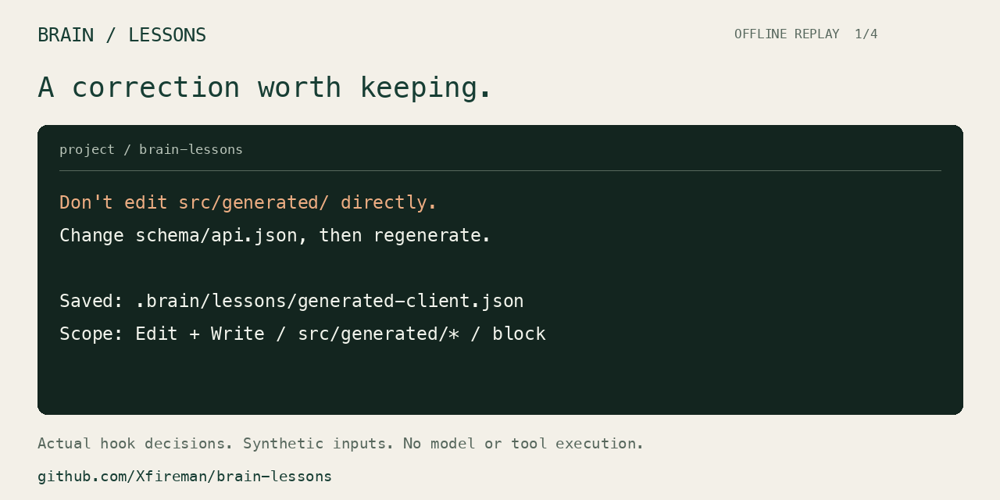

# Brain Lessons

**Turn recurring corrections into checks that run when your coding agent acts.**

For project rules such as “edit the schema before regenerating the client” or “use this project's test runner,” Brain Lessons can surface the relevant instruction at the tool call and, when you explicitly choose `block`, refuse a matching operation.

It packages rule storage, matching, examples, and host integration into one small tool. **It is an early rule-execution component:** saving a lesson is explicit; it does not automatically learn from conversations.

Codex first · Claude Code supported · Local files · No model calls · Python 3.10+

[中文](README.zh-CN.md) · [Rule format](docs/rules.md) · [Privacy & limits](SECURITY.md) · [Contribute](CONTRIBUTING.md)



*Offline replay of actual hook decisions; no model or tool execution.*

## A concrete problem it can help with

Suppose `src/generated/` is produced from `schema/api.json`. Direct edits to generated files will disappear the next time the client is regenerated. You have already explained this convention, but the agent proposes another patch to a generated file.

After you save the matching rule and enable the integration:

```text
Codex proposes an apply_patch edit to src/generated/client.py
  → Brain matches the generated-client rule
  → The host refuses this patch
  → The agent receives the reason and the rule's source:
    “Update schema/api.json, then regenerate the client.”
```

The immediate benefit is a repeatable check on that known mistake. The agent still has to choose the next correct action. A rule can also use `remind` to supply context while letting the current call continue.

This example describes a matching tool call. It does not prevent every way of changing a file: an arbitrary shell script is outside this file-rule check.

## Why not just tell Codex to remember?

For preferences and general instructions, **telling Codex to remember is usually the simpler choice**. Memory and `AGENTS.md` can persist too; persistence alone is not Brain's differentiator.

- **Stored instructions** inform the model, which then has to apply them to its actions.
- **A Brain `block` rule** is checked by code at the tool boundary. With the hook installed, trusted, and enabled, the host rejects a matching call.
- **A Brain `remind` rule** supplies the relevant instruction at that moment. It does not enforce compliance.

You can also ask Codex to write equivalent hooks or checks directly. Brain packages that work into a shared format, repeatable validation, and reversible integrations; it does not give Codex an exclusive new ability.

## When it earns its place

Use it when the same mistake recurs, the triggering command or file pattern is clear, and you want:

- **A check at the relevant action:** a generated-file patch or a known wrong command.
- **Evidence you can inspect:** the matching lesson and its source are shown; `check` runs your positive and negative examples.
- **Rules you can maintain:** ordinary JSON files that you can review, version, and reuse after checking their assumptions in the new project.
- **A small integration to maintain:** the same lesson store works with Codex and Claude Code, with separate install/uninstall controls.

For “reply in Chinese,” broad judgment calls such as “be more careful,” or occasional reminders, start with normal agent instructions. If you already maintain equivalent hooks and checks, keeping those may be simpler.

Brain itself needs no API key, database, or background service. Your coding agent keeps its normal setup, and selected lessons still enter that host's context; see [privacy boundaries](SECURITY.md).

**What this version does today:** you or your agent explicitly write lessons. The installed hook loads matching rules during tool calls. It does not archive conversations, automatically extract corrections, or replace a full personal knowledge system. There are no measured claims here about productivity, token savings, or error reduction.

## Try the mechanism first

Clone or download this repository, then run from its directory:

```sh
python3 -m venv .venv
.venv/bin/python -m pip install .
.venv/bin/brain-lessons demo --scenario generated-client
```

The offline replay saves a generated-file rule, checks a matching and an allowed example, and feeds both patches to the actual Codex hook handler. It calls no model, executes no patch, and changes none of your files. [Reproduce the demo](docs/demo.md).

## Use it in a project

**Install once → describe a correction → review its scope → work normally.**

### 1. Install the hook and the Codex skill

From the repository where you installed the CLI above:

```sh
export PATH="$PWD/.venv/bin:$PATH"
cd /path/to/your/project
brain-lessons init
brain-lessons install codex --with-skill
```

This adds one project hook in `.codex/hooks.json` and the **brain-remember** skill in `.agents/skills/brain-remember/`. Existing hooks and unrelated skills are preserved. The skill uses the exact Python environment that installed it, so Codex does not need to inherit your terminal's PATH. Keep that environment in place. No extra model API key is required by Brain Lessons.

Start a new Codex session in this project, with hooks enabled, and **review and trust the exact hook in `/hooks`**. The project must also be trusted. If hooks were disabled, start the CLI with `codex --enable hooks`. Installation never grants trust or changes global configuration.

The same command upgrades a previous hook-only installation. Hand-edited skill files cause a visible conflict instead of being overwritten. The generated skill embeds local executable paths and carries a `.gitignore`; reinstall it on each machine. Share reviewed `.brain/lessons/*.json` rules separately.

### 2. Describe the correction in Codex

Adapt the paths to your project, then say:

```text
$brain-remember Save a blocking rule: don't edit src/generated/ directly.
Change schema/api.json, then regenerate. Editing src/main.py is allowed.
Show the matching scope and check the examples.
```

The skill reads the relevant project context, builds a narrow candidate, and runs `learn --dry-run` to check both examples **before writing**. It shows the scope, saves within your request, and verifies the saved rule. If you ask for a preview only, it stops before saving. If the paths are unclear, it asks instead of guessing.

Use `$brain-remember` explicitly for a clear entry point. Codex can also select it when your request matches its description; implicit selection is model-dependent. This is agent-assisted authoring, not background collection of your conversations. Preferences such as "keep replies short" still belong in ordinary instructions or memory.

You can also write the equivalent rule yourself:

```sh
brain-lessons learn generated-client \
  --title "Generated clients follow the schema" \
  --instruction "src/generated/ is produced from schema/api.json. Update the schema, then regenerate the client." \
  --tool Edit --tool Write \
  --path "src/generated/*" \
  --sample-path "src/generated/client.py" \
  --miss-path "src/main.py" \
  --action block --dry-run
```

This prints candidate JSON, two checked examples, and any problems without saving. Once satisfied, run the same command without `--dry-run`, then:

```sh
brain-lessons check
brain-lessons recall --tool Edit --path src/generated/client.py
brain-lessons recall --tool Edit --path src/main.py
```

In an empty store, the check should report one rule, two examples, and zero problems. The first preview shows a block; the second has no match. The rule lives in `.brain/lessons/generated-client.json`. Existing IDs are never silently overwritten. `remind` is the default; use `block` only when you want matching calls denied.

### 3. Work normally, or undo the installation

Once the hook is active, the host checks matching calls automatically. Rule edits are loaded on the next call; no reinstall is needed. A changed hook definition needs trust review again. Generated-path rules cover native Codex `apply_patch`, including multi-file edits and both sides of moves; they do not inspect arbitrary shell-based writes.

```sh
brain-lessons uninstall codex --with-skill
```

This removes the managed hook and unmodified managed skill files, while keeping lessons, other hooks, and other skills. Edited skill files are preserved and reported as a conflict. Without `--with-skill`, install/uninstall retains the original hook-only behavior.

A reminder adds context; a block returns the host's `deny` decision for the matching call. Brain never grants permissions. See the official [hook contract](https://learn.chatgpt.com/docs/hooks) and [skill discovery documentation](https://learn.chatgpt.com/docs/build-skills). Installation targets macOS and Linux; native host acceptance is currently macOS only.

**Trying it for the first time?** Follow the [short trial guide](docs/try-it.md) and tell us where the workflow breaks. A useful result includes a false positive or a reason you preferred plain instructions.

## Claude Code support

```sh
brain-lessons install claude-code
# Later, to remove only the Claude Code integration:
brain-lessons uninstall claude-code
```

Claude Code uses `.claude/settings.local.json`. Codex and Claude Code share the lesson store but install and uninstall independently. Start a new session and inspect `/hooks` after installation.

See the [official Claude Code hook contract](https://code.claude.com/docs/en/hooks#pretooluse-decision-control). Other agents can call `recall` explicitly; native integrations are provided for Codex and Claude Code.

## Commands

- `init` — create the local store without overwriting existing files.
- `learn` — save a correction; `--dry-run` checks positive and negative examples without writing.
- `list` — inspect the complete rule set.
- `recall` — preview matching rules without running the proposed command.
- `check` — validate rules and run their positive/negative examples.
- `install codex --with-skill` / `uninstall codex --with-skill` — manage the Codex hook and natural-language skill. Omit the flag for hook-only behavior; `claude-code` also supports hooks.
- `demo --scenario generated-client` — replay the generated-file example offline; add `--json` for actual decisions. `demo` alone retains the test-runner example.

Use `--help` for arguments. Global `--root /path/to/project` goes before the command. JSON output is available for `list`, `recall`, and `check`.

## Limits that matter

- Matching uses literal shell-token sequences and path globs. It is **not a full shell interpreter or a security sandbox**. Aliases, variables, command substitutions, scripts and alternative tools can behave differently. A phrase can match arguments to another program. Review your examples.
- Codex file rules inspect `apply_patch` operations, not files changed indirectly by arbitrary shell commands. A later `write_stdin` call does not trigger another pre-tool check for the original shell command.
- A reminder adds context. It does not stop the current tool call. Use an explicit block only where the trigger itself is the unwanted operation.
- Bad rules are reported by `check` and skipped by the hook. Invalid hook input returns no decision. This is deliberately unsuitable as your sole safety control.
- Up to three matching lessons are shown, with blocks first and an omitted count. Review all rules with `list`.
- Rules can contain sensitive instructions. Matching rules are sent to the agent host and can enter its transcript or model context. Local storage does not make the host local.
- This is an early release. No benchmark claim is made about productivity, token savings, or error reduction.

## Development

Native smoke tests use **Codex CLI 0.162.1 on macOS** with a local synthetic response server. With rules disabled, the fixture commands and patch execute; with rules enabled, Codex blocks the selected shell call and patch while a permitted command still runs, and a reminder reaches the next model request. This verifies actual host behavior without a paid model call. Other Codex surfaces need the compatible hook runtime and access to the installed Python executable.

```sh
python3 -B -m unittest discover -s tests -v
```

The tests exercise real CLI subprocesses, isolated files, installed hook commands, malformed data, privacy boundaries, and positive/negative matching. No credentials or paid models are needed.

With Codex CLI 0.162.1 on PATH, run the native host smoke test:

```sh
python3 -B tests/native_codex.py
```

It creates an isolated Codex home, records trust only for the reviewed fixture hook's exact hash, and uses a loopback response server. It does not use your login, modify your real Codex settings, or measure a model's intelligence. The CI runs this test separately from the CLI suite.

The native CI job runs on macOS with Codex's default workspace filesystem sandbox and tool network isolation. Linux runs the CLI integration suite; native Linux enforcement has not been validated for this release because the hosted Ubuntu worker cannot start Codex's bubblewrap namespaces. The test does not relax the sandbox or silently switch backends. Normal installation never changes sandbox or network settings.

If Brain helps, contribute a **synthetic** lesson and a failing example it catches. Please never upload a real transcript, credential, or internal project configuration.
